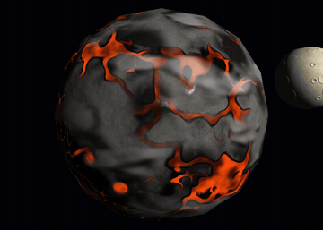
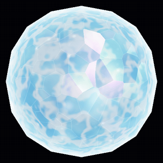
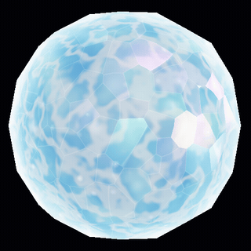
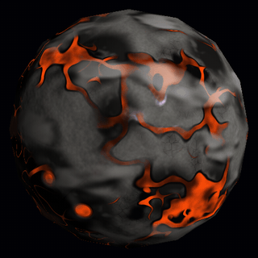
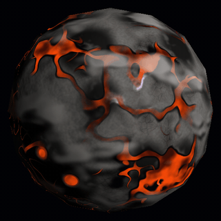
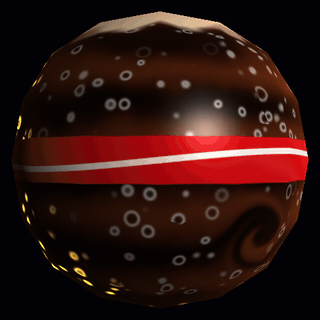
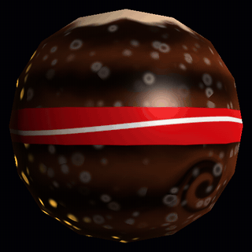

# Lab 6 — Planetas y estrellas con shaders

Tres cuerpos celestes hechos con la misma esfera (`assets/sphere.obj`) en el software renderer en CPU. Toda la apariencia sale de fragment shaders procedurales, sin texturas.

## Compilación y ejecución

Requiere Rust y las dependencias de sistema de raylib.

```bash
cargo run --release
```

Para guardar capturas de los tres cuerpos en `capturas/`:

```bash
cargo run --release -- --captura
```

## Selección de shader y controles

| Tecla | Acción |
|---|---|
| **1** | Estrella |
| **2** | Planeta rocoso (con su luna) |
| **3** | Gigante gaseoso |
| **W A S D** / flechas | Orbitar la cámara |
| **Q** / **E** | Acercar / alejar |
| **J** / **L** | Girar la luz |
| **Espacio** | Pausar el tiempo |
| **R** | Reiniciar cámara y luz |

## Cuerpos celestes

### 1. Estrella de cristal

`src/shaders/star.rs`, `crystal_star`


Estrella blanca y celeste con apariencia de cristal: facetas que reflejan la luz en colores, destellos y un aura en el borde.

**Patrones y cómo se combinan:**
- **Interior:** un `fbm` animado forma el plasma y las zonas calientes. Las vetas son la línea media de otro `fbm`. Ambos se calculan en un punto desplazado según la vista (parallax).
- **Color:** el plasma define el color entre azul, celeste y blanco. Encima se suma un núcleo blanco al centro, que depende de `n·v`.
- **Facetas:** ruido celular (Voronoi). Cada celda inclina su normal y las aristas se aclaran suavemente.
- **Reflejo de colores:** cada faceta tiene un brillo especular (Blinn-Phong) teñido con un arcoíris pastel según la faceta y el ángulo de vista.
- **Destellos:** cada celda parpadea con su propia fase.
- **Aura:** un borde Fresnel `(1 - n·v)²`.
- **Tone mapping:** `1 - e^(-c)` mantiene el brillo sin quemar los tonos.
- Es emisiva: no se oscurece del lado sin luz.

**Parámetros:**

| Parámetro | Efecto visual |
|---|---|
| `FACET_SCALE` | tamaño de las facetas |
| `FACET_TILT` | dispersión de los reflejos |
| `PARALLAX_DEPTH` | profundidad del interior |
| `SPARKLE_SPEED` | velocidad de los destellos |
| `AURA_STRENGTH` | fuerza del aura |
| `EXPOSURE` | luminosidad |

### 2. Planeta volcánico

`src/shaders/rocky.rs`, `volcanic`


Planeta en ruinas donde los océanos y ríos se volvieron lava: mares y ríos de lava, costas de obsidiana, roca gris agrietada, ceniza, volcanes y nubes de ceniza.

**Patrones y cómo se combinan:**
- **Continentes** (`terrain`): un `fbm` con *domain warping*. Debajo de `LAVA_LEVEL` hay mar de lava con costas irregulares.
- **Ríos** (`river_field`, `river`): siguen la línea media de un `fbm` deformado, con cauce principal y afluentes. Se ensanchan cerca del mar.
- **Volcanes** (`volcano`): conos con cráter en algunas celdas de una malla 3D.
- **Materiales:**
  - obsidiana en costas, orillas y cráteres;
  - roca con manchas `fbm`, placas agrietadas (bordes de ruido celular) y grano fino;
  - ceniza en las zonas altas.
- **Lava** emisiva, con una corteza que fluye con el tiempo.
- Encima: relieve, nubes, sombras de nubes y grietas nocturnas (ver efectos).

**Parámetros:**

| Parámetro | Efecto visual |
|---|---|
| `LAVA_LEVEL` | cantidad de mar de lava |
| `RIVER_WIDTH` | ancho de los ríos |
| `OBSIDIAN_WIDTH` | ancho de la obsidiana |
| `OBSIDIAN_SHININESS` | nitidez del reflejo |
| `VOLCANO_DENSITY` | cantidad de volcanes |
| `CRACK_CELL_SCALE` | tamaño de las placas agrietadas |
| `BUMP_STRENGTH` / `SOIL_ROUGHNESS` | relieve |
| `CLOUD_COVERAGE` / `CLOUD_SPEED` / `CLOUD_HEIGHT` | nubes y sus sombras |
| `CRACK_WIDTH` | grietas nocturnas |

### 3. Gigante gaseoso de coca

`src/shaders/gas_giant.rs`, `coca_giant`


Planeta de coca: bandas oscuras que fluyen como líquido, burbujas de gas, espuma en el polo, un remolino y una franja roja tipo etiqueta. En el lado oscuro, las burbujas brillan dorado.

**Patrones y cómo se combinan:**
- **Remolino** (`vortex`): las coordenadas se giran alrededor de un centro antes de calcular las bandas.
- **Bandas:** un seno de la latitud. Cada latitud gira a distinta velocidad y dos `fbm` deforman las bandas, así las transiciones se ven líquidas.
- **Color:** cuatro tonos de café con transiciones anchas y una variación lenta de tono.
- **Espuma** en el polo norte, con borde de ruido.
- **Burbujas** (`bubbles`): ruido celular que sube con el tiempo. Cada burbuja crece y revienta, y su borde es una caída gaussiana difuminada.
- **Etiqueta:** franja roja en el ecuador con una cinta blanca ondulada.
- **Iluminación:** difusa, brillo especular de líquido y borde ámbar.

**Parámetros:**

| Parámetro | Efecto visual |
|---|---|
| `BAND_FREQUENCY` | cantidad de bandas |
| `TURBULENCE` | turbulencia de las transiciones |
| `FLOW_SPEED` | velocidad del flujo |
| `BUBBLE_SCALE` / `BUBBLE_DENSITY` / `BUBBLE_RISE` / `BUBBLE_SOFTNESS` | burbujas |
| `STORM_RADIUS` / `STORM_STRENGTH` | remolino |
| `GLOW_STRENGTH` | brillo dorado nocturno |
| `LABEL_WIDTH` | ancho de la etiqueta |

### Luna del planeta rocoso

`src/shaders/moon.rs`, `pale_moon` · órbita en `src/main.rs`, `scene`


Luna pálida, entre amarillo beige y blanco, con superficie rocosa llena de cráteres. Es otra instancia de la misma esfera: se escala y se traslada con su matriz de modelo, sin modificar los vértices. Orbita al planeta rocoso (tecla **2**) y el z-buffer la oculta cuando pasa detrás.

**Patrones y cómo se combinan:**
- **Cráteres:** algunas celdas de una malla 3D tienen un cráter de tamaño aleatorio, con hundimiento y borde elevado. Entran a un campo de altura que modifica la normal (bump mapping), por lo que responden a la luz.
- **Color:** un `fbm` mezcla beige y blanco. Otro `fbm` de baja frecuencia forma zonas más oscuras tipo "mares". Los fondos de los cráteres son un poco más oscuros.
- **Grano fino** de roca con ruido de alta frecuencia.

**Parámetros:**

| Parámetro | Efecto visual |
|---|---|
| `CRATER_SCALE` / `CRATER_DENSITY` | tamaño y cantidad de cráteres |
| `BUMP_STRENGTH` (en `moon.rs`) | profundidad de los cráteres |
| `MOON_SIZE` / `MOON_ORBIT` / `MOON_SPEED` (en `main.rs`) | tamaño, radio y velocidad de la órbita |



## Efectos implementados

### Material animado: Estrella

- **Implementación:** `src/shaders/star.rs`, `crystal_star` y `sparkle_at`.
- **Funcionamiento:** el plasma interno se desplaza con el tiempo y cada faceta tiene un destello con su propia fase y velocidad. La esfera no se mueve.
- **Parámetro:** `SPARKLE_SPEED`. Más alto, los destellos parpadean más rápido.



### Parallax dependiente de la vista: Estrella

- **Implementación:** `src/shaders/star.rs`, `crystal_star`.
- **Funcionamiento:** un campo de altura `fbm` define la profundidad del interior. El punto donde se calculan las vetas y el plasma se desplaza según la componente tangente de la vista, dividida entre `n·v`. Al mover la cámara, el interior se desliza respecto de la superficie. En el video el tiempo está detenido: solo se mueve la cámara.
- **Parámetro:** `PARALLAX_DEPTH`. Más alto, el interior se ve más profundo y se desplaza más.



### Apariencia de día y noche: Planeta rocoso

- **Implementación:** `src/shaders/rocky.rs`, `volcanic`.
- **Funcionamiento:** un factor `night`, que vale 1 donde no llega la luz, activa una red de grietas incandescentes (los cruces por cero de un ruido). Las grietas solo se ven en el lado nocturno.
- **Parámetro:** `CRACK_WIDTH`. Más alto, las grietas son más gruesas.



### Respuestas diferentes a la iluminación: Planeta rocoso

- **Implementación:** `src/shaders/rocky.rs`, `volcanic`.
- **Funcionamiento:** cada material responde distinto a la luz:
  - la roca y la ceniza son mate (solo difusa);
  - la obsidiana tiene un reflejo especular Blinn-Phong nítido y un borde Fresnel;
  - la lava es emisiva.
- En el video de arriba, el reflejo recorre la obsidiana al girar la luz.
- **Parámetro:** `OBSIDIAN_SHININESS`. Más alto, el reflejo es más pequeño y vidrioso.

### Nubes procedurales: Planeta rocoso

- **Implementación:** `src/shaders/rocky.rs`, `cloud_mask` y `volcanic`.
- **Funcionamiento:** la máscara de nubes es un `fbm` que gira a su propia velocidad, independiente del terreno, y cambia de forma con una deformación lenta. Se mezcla sobre la superficie en la misma esfera.
- **Parámetro:** `CLOUD_COVERAGE`. Con 0 el cielo queda limpio; con 1, cubierto.



### Sombras de nubes: Planeta rocoso

- **Implementación:** `src/shaders/rocky.rs`, `volcanic`.
- **Funcionamiento:** la misma `cloud_mask` se evalúa en el punto `p + l · CLOUD_HEIGHT / (n·l)`, que es la nube que tapa la luz sobre `p`. Por eso la sombra tiene la forma de las nubes, se mueve con ellas y se desplaza según la dirección de la luz (videos de nubes y de luz).
- **Parámetro:** `CLOUD_HEIGHT`. Más alto, la sombra se separa más de su nube.

### Tormenta o vórtice localizado: Gigante gaseoso

- **Implementación:** `src/shaders/gas_giant.rs`, `vortex` y `coca_giant`.
- **Funcionamiento:** antes de calcular las bandas, las coordenadas se rotan alrededor del centro de la tormenta (fórmula de Rodrigues). El ángulo es mayor cerca del centro y cae a cero en `STORM_RADIUS`, así las bandas se curvan en espiral hacia el ojo.
- **Parámetro:** `STORM_STRENGTH`. Más alto, la espiral da más vueltas.



### Relieve procedural mediante bump mapping: Planeta rocoso

- **Implementación:** `src/shaders/rocky.rs`, `height` y `volcanic`.
- **Funcionamiento:** un campo de altura (conos volcánicos, rugosidad `fbm` y grano fino) se evalúa en el punto y en dos desplazamientos tangentes. La pendiente que sale de esas diferencias finitas inclina la normal que se usa para iluminar, sin modificar los vértices.
- En el video de día y noche, el relieve cambia de sombra al girar la luz.
- **Parámetro:** `BUMP_STRENGTH`. Más alto, el relieve se ve más profundo; con 0, la superficie es plana.

### Extra de diseño: burbujas doradas en el lado oscuro (Gigante gaseoso)

Usa el mismo principio de día y noche: el brillo solo aparece donde no llega la luz.


