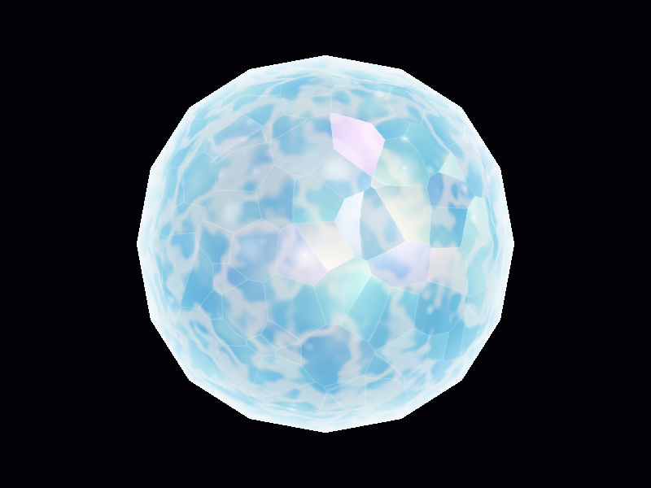
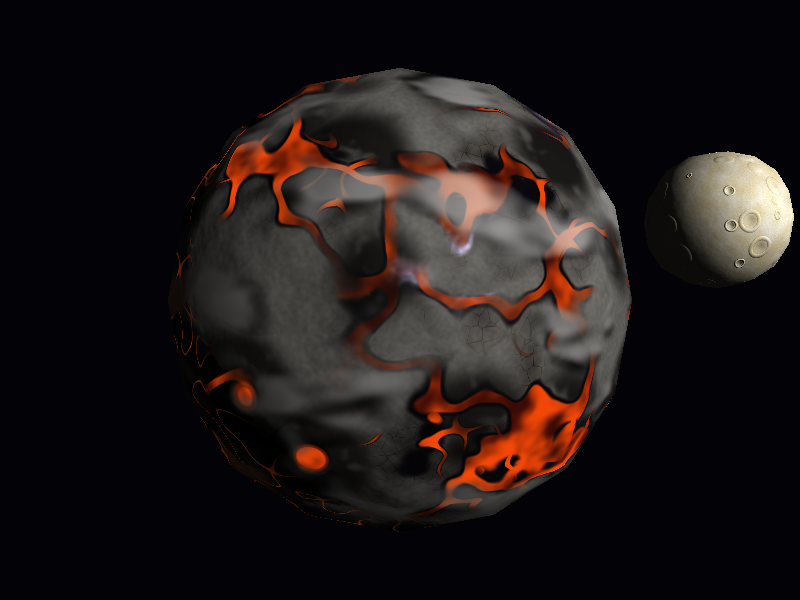
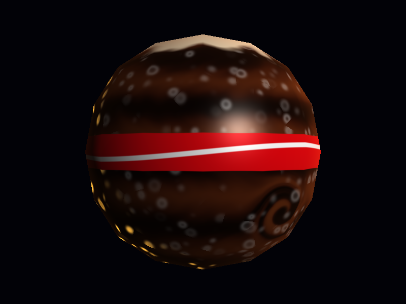
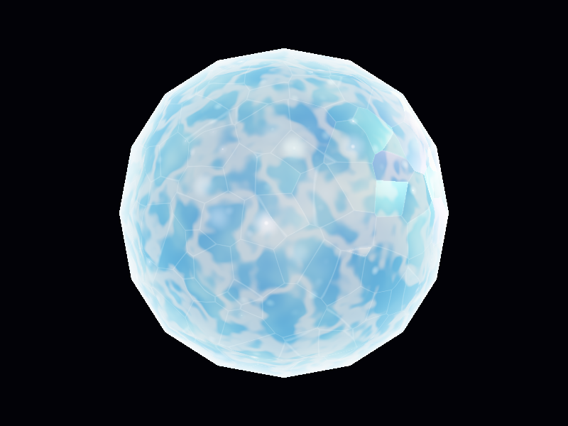
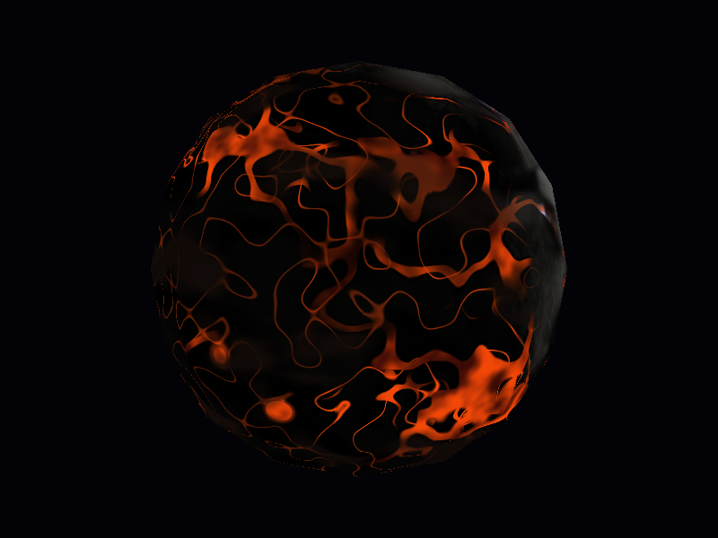
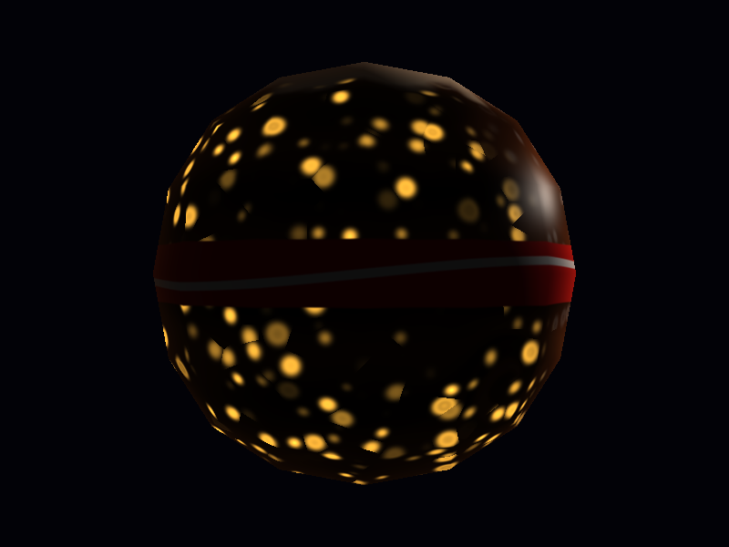

# Lab 6 — Planetas y estrellas con shaders

Tres cuerpos celestes dibujados con **la misma esfera** (`assets/sphere.obj`) en un **software renderer en CPU** escrito en Rust. La geometría no cambia: toda la apariencia sale de **fragment shaders procedurales** (coordenadas de la esfera, normales, intensidad de luz, tiempo, funciones matemáticas y ruido OpenSimplex). No se usan imágenes, texturas ni otros modelos.

| Estrella de cristal | Planeta volcánico | Gigante gaseoso de cola |
|:---:|:---:|:---:|
|  |  |  |

## Compilar y ejecutar

Requisitos: Rust (edición 2024) y las dependencias de sistema de raylib (cmake, compilador C, librerías de X11/OpenGL).

```bash
cargo run --release
```

> Usa `--release`: el renderer es por software y en modo debug es mucho más lento.

Otros modos:

```bash
cargo run --release -- --captura   # guarda capturas/<cuerpo>.png y capturas/<cuerpo>_lado_oscuro.png
```

### Controles

| Tecla | Acción |
|---|---|
| **1** / **2** / **3** | Estrella / planeta rocoso / gigante gaseoso |
| **W A S D** o flechas | Orbitar la cámara |
| **Q** / **E** | Acercar / alejar |
| **J** / **L** | Girar la luz alrededor del planeta |
| **Espacio** | Pausar / reanudar el tiempo |
| **R** | Reiniciar cámara y luz |

## Cómo funciona el renderer

`render()` en `src/main.rs` sigue el pipeline visto en clase:

1. **Vertex shader** (`src/pipeline.rs`, `vertex_shader`): modelo → mundo → cámara → proyección en perspectiva → pantalla. Se descartan las caras traseras (`is_back_face`).
2. **Rasterización** (`src/triangle.rs`, `triangle`): relleno con coordenadas baricéntricas y regla *top-left*. Los vértices se ajustan a una malla de 1/256 de píxel y las aristas se calculan en `f64`, así no quedan grietas entre triángulos. La posición, la normal y la profundidad se interpolan con corrección de perspectiva.
3. **Prueba de profundidad** y **fragment shader** (`src/shaders/mod.rs`, `fragment_shader`), que elige el shader del cuerpo activo. El sombreado se reparte entre los núcleos del CPU con hilos de la librería estándar.

Cada `Fragment` (`src/fragment.rs`) entrega a los shaders:
- `object_position`: el punto de la esfera unitaria, base de todos los patrones;
- `normal`: la normal suave, porque el `.obj` trae normales planas por cara y se usa la dirección desde el centro;
- `intensity`: la iluminación difusa `max(n·l, 0)`.

Las funciones auxiliares de ruido están en `src/shaders/noise_helpers.rs`:
- `sample`: ruido OpenSimplex;
- `fbm` y `fbm_octaves`: suma de octavas;
- `cellular`: ruido celular tipo Voronoi, con `hash` y `hash3`.

---

## 1. Estrella de cristal

`src/shaders/star.rs`, función `crystal_star`

Una estrella blanca y celeste que parece hecha de cristal: brilla con luz propia, refleja la luz en sus facetas con colores iridiscentes, tiene destellos que parpadean y un aura en el borde.

| Lado iluminado | Luz de costado |
|:---:|:---:|
|  |  |

**Patrones y cómo se combinan:**

1. **Interior con profundidad (parallax):** un campo de altura (`fbm`) desplaza el punto de muestreo en contra de la dirección de vista. Con ese punto desplazado se calculan un plasma (`fbm` que se desplaza con el tiempo) y unas vetas, que son la línea media de un `fbm`.
2. **Gradación de color:** el plasma decide entre azul profundo, celeste y blanco. Encima va un núcleo blanco caliente que depende de `n·v`, así que el centro brilla más que el borde.
3. **Facetas:** ruido celular (`cellular`). Cada celda inclina su normal de forma aleatoria y las aristas entre celdas se aclaran suavemente.
4. **Reflejo de colores:** cada faceta tiene un brillo especular (Blinn-Phong) que se tiñe con un arcoíris pastel (`iridescent`). El tono depende de la faceta, del ángulo de vista y del tiempo.
5. **Destellos:** hay dos capas de celdas, las facetas y un brillo fino. Cada celda parpadea con su propia fase y velocidad (`sparkle_at`).
6. **Aura:** un resplandor tipo Fresnel, `(1 - n·v)²`, en el borde de la silueta.
7. **Tone mapping** `1 - e^(-c·exposición)`: permite que brille mucho sin quemarse a blanco plano.

La estrella es **emisiva**: no se oscurece del lado contrario a la luz y usa la luz solo para los reflejos.

**Parámetros:**

| Parámetro | Qué controla |
|---|---|
| `FACET_SCALE` | tamaño de las facetas |
| `FACET_TILT` | dispersión de los reflejos |
| `PARALLAX_DEPTH` | profundidad aparente del interior |
| `SPARKLE_SPEED` | velocidad de los destellos |
| `AURA_STRENGTH` | fuerza del aura |
| `EXPOSURE` | luminosidad general |

## 2. Planeta volcánico

`src/shaders/rocky.rs`, función `volcanic`

Un planeta en ruinas donde los océanos y los ríos se volvieron lava. Mares y ríos de lava, costas de obsidiana vidriosa, roca gris agrietada, ceniza en las zonas altas, volcanes con cráteres encendidos y nubes de ceniza gris que proyectan sombra.

| Lado iluminado | Luz de costado (grietas nocturnas) |
|:---:|:---:|
|  |  |

**Patrones y cómo se combinan:**

1. **Continentes** (`terrain`): un `fbm` con el dominio deformado por otro ruido (*domain warping*). Debajo de `LAVA_LEVEL` hay mar de lava, y por la deformación las costas salen irregulares.
2. **Ríos** (`river_field`, `river`): siguen la línea media de un `fbm` deformado, con un cauce principal y afluentes. El ancho varía con el ruido y crece cerca del mar. Los ríos se apagan en las zonas altas.
3. **Volcanes** (`volcano`): algunas celdas de una malla 3D tienen un cono con cráter, cada uno de su tamaño. Se revisan las celdas vecinas para que los conos no se corten.
4. **Materiales:**
   - obsidiana en las costas, las orillas de los ríos y los cráteres;
   - tierra en varias escalas: manchas grandes de roca gris (`fbm`), parches de tono más cálido, placas de tierra seca agrietada (bordes de ruido `cellular`) y un grano fino tipo grava;
   - ceniza en lo alto, mezclada con ruido fino;
   - basalto con vetas de ceniza en las laderas.
5. **Lava** emisiva, con una corteza que fluye con el tiempo y un resplandor en el borde de los cráteres.
6. **Relieve** (`height`): conos, rugosidad de la roca y grano fino de la tierra.
7. **Nubes de ceniza** (`cloud_mask`) y sus sombras.
8. **Grietas nocturnas.**

Los pasos 6 a 8 son efectos del menú y se explican abajo.

**Parámetros:**

| Parámetro | Qué controla |
|---|---|
| `LAVA_LEVEL` | cuánta superficie es mar de lava |
| `RIVER_WIDTH` | ancho de los ríos |
| `OBSIDIAN_WIDTH` | ancho de la obsidiana |
| `OBSIDIAN_SHININESS` | nitidez del reflejo |
| `VOLCANO_SCALE` / `VOLCANO_DENSITY` | tamaño y cantidad de volcanes |
| `BUMP_STRENGTH` | fuerza del relieve |
| `SOIL_ROUGHNESS` | rugosidad fina de la tierra |
| `CRACK_CELL_SCALE` | tamaño de las placas de tierra agrietada |
| `CLOUD_COVERAGE` / `CLOUD_SPEED` / `CLOUD_HEIGHT` | nubes |
| `CRACK_WIDTH` | grietas nocturnas |

## 3. Gigante gaseoso de cola

`src/shaders/gas_giant.rs`, función `cola_giant`

Un planeta de refresco de cola: bandas oscuras que fluyen como líquido, burbujas de gas que suben y revientan, espuma en el polo norte, un remolino que curva las bandas y una franja roja tipo etiqueta con una cinta blanca ondulada. En el lado oscuro, las burbujas brillan con luz dorada.

| Lado iluminado | Luz de costado (burbujas doradas) |
|:---:|:---:|
|  |  |

**Patrones y cómo se combinan:**

1. **Remolino** (`vortex`): primero se giran las coordenadas alrededor de un centro del hemisferio sur, con más fuerza cerca del ojo.
2. **Flujo líquido:** con esas coordenadas, cada latitud gira a distinta velocidad (cizalla). Dos `fbm` deforman el seno que forma las bandas, así que las transiciones se ven como líquido y no como franjas rectas.
3. **Gradación de cafés:** cuatro tonos (negro cola, café oscuro, café medio y caramelo) con transiciones anchas y una variación lenta de tono a lo largo de las bandas.
4. **Espuma:** cubre el polo norte, con un borde irregular de ruido.
5. **Burbujas** (`bubbles`): ruido celular que se desplaza hacia arriba con el tiempo. Cada celda tiene una burbuja que crece y revienta con su propio ciclo. El borde es una caída gaussiana, así que se ve difuminado.
6. **Etiqueta:** una franja roja en el ecuador con una cinta blanca que ondula según la longitud.
7. **Iluminación:** luz difusa, un brillo especular de líquido y un borde ámbar de atmósfera.
8. **Lado oscuro:** las burbujas emiten luz dorada propia, con más intensidad cuanto menos luz recibe la zona.

**Parámetros:**

| Parámetro | Qué controla |
|---|---|
| `BAND_FREQUENCY` | cantidad de bandas |
| `TURBULENCE` | qué tan turbulentas son las transiciones |
| `FLOW_SPEED` | velocidad del flujo |
| `BUBBLE_SCALE` / `BUBBLE_DENSITY` / `BUBBLE_RISE` / `BUBBLE_SOFTNESS` | burbujas |
| `STORM_RADIUS` / `STORM_STRENGTH` | remolino |
| `GLOW_STRENGTH` | brillo dorado nocturno |
| `LABEL_WIDTH` | ancho de la etiqueta |

---

## Efectos adicionales implementados

Para cada efecto se indica el cuerpo, el archivo y la función, cómo funciona, un parámetro que se puede modificar y cómo verlo en el programa.

### Material animado (5): Estrella

- **Implementación:** `src/shaders/star.rs`, `crystal_star` (pasos 2 y 5) y `sparkle_at`.
- **Cómo funciona:** el plasma interno se desplaza con el tiempo y cambia las zonas calientes. Cada faceta tiene un destello con su propia fase y velocidad. La esfera no se mueve: solo cambia el patrón.
- **Parámetro:** `SPARKLE_SPEED`. Si sube, los destellos parpadean más rápido.
- **Cómo verlo:** tecla **1**; el plasma y los destellos cambian con el tiempo (**Espacio** pausa).

### Parallax dependiente de la vista (15): Estrella

- **Implementación:** `src/shaders/star.rs`, `crystal_star` (paso 1).
- **Cómo funciona:** un campo de altura procedural (`fbm`) define a qué profundidad está el interior. El punto donde se calculan las vetas y el plasma se desplaza según la componente tangente del vector de vista, dividida entre `n·v`. Al orbitar la cámara, el interior se desliza respecto de las facetas de la superficie, como si estuviera debajo del cristal. Se ve mejor con el tiempo pausado (**Espacio**): lo único que se mueve es la cámara.
- **Parámetro:** `PARALLAX_DEPTH`. Más alto da un interior más profundo, que se desplaza más al mover la cámara.
- **Cómo verlo:** tecla **1**, pausar con **Espacio** y orbitar con **A/D**.

### Apariencia de día y noche (5): Planeta volcánico

- **Implementación:** `src/shaders/rocky.rs`, `volcanic` (paso 6).
- **Cómo funciona:** el factor `night` vale 1 donde la superficie no recibe luz y 0 donde sí, con transición en el terminador. Multiplica a una red de grietas incandescentes: los cruces por cero de un ruido. Las grietas solo aparecen en el lado nocturno.
- **Parámetro:** `CRACK_WIDTH`. Si sube, las grietas son más gruesas y brillantes.
- El gigante gaseoso usa la misma idea para sus burbujas doradas (`GLOW_STRENGTH`).
- **Cómo verlo:** tecla **2** y girar la luz con **J/L**.

|  |
|:---:|

### Respuestas diferentes a la iluminación (10): Planeta volcánico

- **Implementación:** `src/shaders/rocky.rs`, `volcanic` (pasos 3 y 5).
- **Cómo funciona:** cada material usa un modelo de luz distinto:
  - la **piedra y la ceniza** son mate: solo luz difusa;
  - la **obsidiana** es casi negra, con un reflejo especular Blinn-Phong pequeño y nítido y un reflejo de borde violeta (Fresnel). El reflejo se mueve al girar la luz o la cámara;
  - la **lava** es emisiva y no depende de la luz.
- **Parámetro:** `OBSIDIAN_SHININESS`. Más alto da un reflejo más pequeño y vidrioso; más bajo, un brillo más amplio y satinado.
- **Cómo verlo:** tecla **2** y girar la luz con **J/L**: el reflejo recorre las costas de obsidiana, mientras la piedra solo se aclara u oscurece y la lava mantiene su brillo.

### Nubes procedurales (10): Planeta volcánico

- **Implementación:** `src/shaders/rocky.rs`, `cloud_mask` y `volcanic` (paso 7).
- **Cómo funciona:** la máscara de nubes es un `fbm` estirado en latitud. Gira alrededor del eje y a su propia velocidad, independiente del terreno (que está fijo), y una deformación lenta la hace cambiar de forma. Se mezcla con la superficie en la misma esfera. El color va de gris ceniza a humo oscuro según el espesor. De noche, la lava ilumina las nubes por debajo.
- **Parámetros:** `CLOUD_COVERAGE` (de 0, cielo limpio, a 1, cubierto) y `CLOUD_SPEED` (velocidad de las nubes).
- **Cómo verlo:** tecla **2**; las nubes y sus sombras se desplazan sobre el terreno fijo. Con **J/L** las sombras cambian de lado según la luz.

### Sombras de nubes (20): Planeta volcánico

- **Implementación:** `src/shaders/rocky.rs`, `volcanic` (paso 4).
- **Cómo funciona:** para cada punto de la superficie se avanza hacia la luz hasta la altura de la capa de nubes: `p + l · CLOUD_HEIGHT / (n·l)`. Ahí se evalúa la misma `cloud_mask`. Si hay nube, ese punto queda en sombra. Por eso las sombras tienen la forma exacta de las nubes, se mueven con ellas y se separan más cuando la luz llega rasante, cerca del terminador.
- **Parámetro:** `CLOUD_HEIGHT`. Más alto separa más la sombra de su nube.
- **Cómo verlo:** tecla **2** y girar la luz con **J/L**: cada sombra se desliza respecto de su nube según la dirección de la luz.

### Tormenta o vórtice localizado (10): Gigante gaseoso

- **Implementación:** `src/shaders/gas_giant.rs`, `vortex` y `cola_giant` (paso 1).
- **Cómo funciona:** antes de calcular las bandas se rotan las coordenadas alrededor del eje que pasa por el centro de la tormenta (fórmula de Rodrigues). El ángulo es mayor cerca del centro y cae suavemente a cero en `STORM_RADIUS`. Así, las bandas que rodean la tormenta se curvan en espiral hacia el ojo oscuro, y el ángulo crece con el tiempo, por lo que el remolino gira.
- **Parámetro:** `STORM_STRENGTH`. Más alto da más vueltas de espiral.
- **Cómo verlo:** tecla **3**; el remolino está en el hemisferio sur, abajo a la derecha en la vista inicial.

### Relieve procedural mediante bump mapping (15): Planeta volcánico

- **Implementación:** `src/shaders/rocky.rs`, `height`, `tangent_basis` y `volcanic` (paso 1).
- **Cómo funciona:** un campo de altura matemático (conos volcánicos con cráter, rugosidad `fbm` y grano fino de la tierra) se evalúa en el punto y en dos desplazamientos sobre la base tangente. Con esas diferencias finitas se obtiene la pendiente, que inclina la normal usada para la luz difusa y el especular. Los vértices no cambian, pero los volcanes y la roca proyectan luz y sombra según de dónde venga la luz.
- **Parámetro:** `BUMP_STRENGTH`. Si sube, el relieve se ve más profundo; con 0 la superficie se ve plana.
- **Cómo verlo:** tecla **2** y girar la luz con **J/L**: los volcanes y el grano de la roca cambian de sombra según de dónde venga la luz.

### Burbujas doradas en el lado oscuro: Gigante gaseoso

Este es parte del diseño del gaseoso y usa el mismo principio que día y noche. Ese criterio ya se reclama arriba con el planeta volcánico.

|  |
|:---:|

## Estructura

```
src/
├── main.rs              # ventana, controles, render() y modo --captura
├── camera.rs            # cámara orbital
├── pipeline.rs          # vertex shader y descarte de caras traseras
├── triangle.rs          # rasterización e interpolación de atributos
├── fragment.rs          # datos de cada fragmento
├── framebuffer.rs       # color, profundidad y exportar PNG
├── obj.rs               # carga del .obj
├── vertex.rs
└── shaders/
    ├── mod.rs           # fragment_shader, mix, smoothstep
    ├── noise_helpers.rs # OpenSimplex, fbm, ruido celular
    ├── star.rs          # estrella de cristal
    ├── rocky.rs         # planeta volcánico
    └── gas_giant.rs     # gigante gaseoso de cola
```
